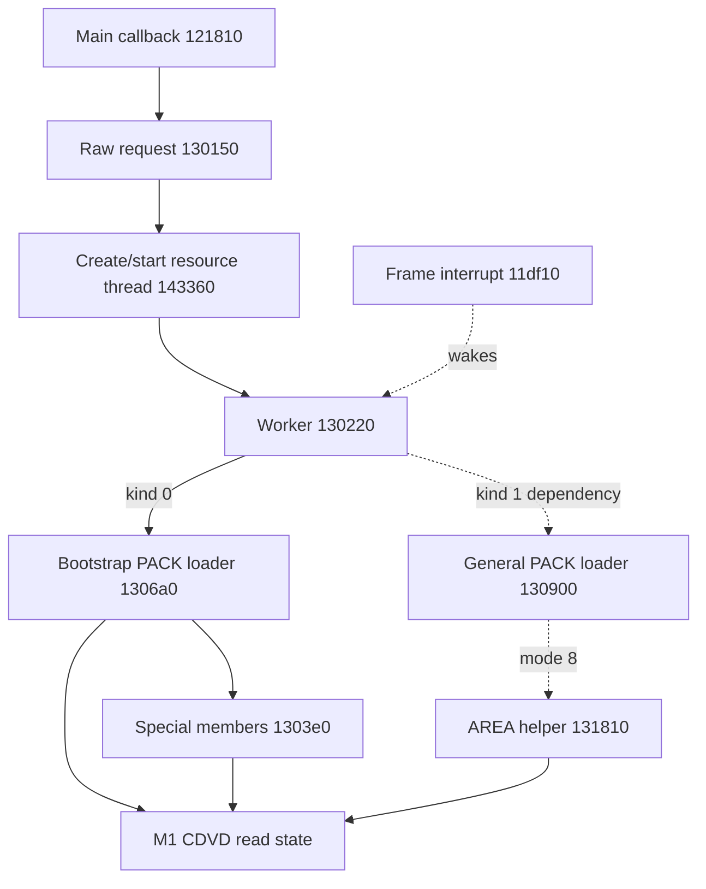

# Scheduler and resource loading: M2 evidence

M4 update: the combined `hg_resource_worker_fixed` operation now resolves FLK5
fixup/rebasing and retains the original member-ID argument at both M2 boundaries.
See [M4 semantics](../resource_fixup/README.md) and [verified retail path](../../docs/M4.md).
The M2 dependency-isolated results below are historical; their external fixup
seam remains available for regression tests.

Reference: original Japanese ELF SHA-256
`a74248c5e2fd2cce9cede6c04d8117ce79e9472d380bbd80eb410370abcf3c61`.
The [instruction packet](functions.json) contains **684 original instruction rows /
2,736 bytes**, checked by PS2DInfo. [Context](context.json) separately records
seven byte-checked origin, interrupt and dependency functions. Their analysis
does not count as reconstructed source.

| Entry | Analyst name | Body bytes |
|---|---|---:|
| 001431f0 | hg_resource_init | 76 |
| 00143360 | hg_resource_schedule | 380 |
| 001434f0 | hg_resource_finish | 52 |
| 00130150 | hg_resource_request_raw | 24 |
| 00130170 | hg_resource_request | 164 |
| 00130220 | hg_resource_worker | 448 |
| 001303e0 | hg_pack_special_step | 652 |
| 001306a0 | hg_pack_bootstrap | 584 |
| 0012fbc0 | hg_area_index | 40 |
| 00131810 | hg_area_read_step | 220 |
| 00131dd0 | hg_area_finalize | 96 |

## Established execution relationships

Main `0011d830` registers `00121810` through `001432c0`; each frame it calls
dispatcher `00143240`. That dispatcher selects the context at `003ead30` via
scratchpad `700000c0`, promotes states 1/4 to 2, and invokes its callback.
`00121810` phase 0 increments its phase and requests **kind 0, directory 0** through
`00130150`; phase 1 waits for request flag `003eacec` to clear.

Request `00130150` sets that flag, clears `003eace0`, and **tail-jumps** to
`00143360` with entry argument `00130220`. The remapping request `00130170` also
tail-jumps directly to the scheduler; its use of the C raw-request helper is a
source-level factoring, not a claimed extra original call edge. It remaps IDs
9/4e/67 to the next ID when the halfword at `003fa1c4` is nonzero.

The resource scheduler creates/starts an EE kernel thread using wrappers
`00103d60` / `00103d80`; it is distinct from the main-context dispatcher.
The normal descriptor at `003f8e00` uses stack `003f6e00`, size 0x2000, priority 5,
and GP `003e7f70`. Its +30 halfword gates busy rejection. Low-halfword kind 100
uses another descriptor at `003f6d80`, stack `003f4d80`, priority 3 and bypasses
the normal busy gate. Its different worker is not reconstructed by M2.
CreateThread failure is passed straight to StartThread; no error handling was
invented. A rejected normal request still has the flag effects of its caller.

The normal worker `00130220` was absent from the M1 automatic inventory. Targeted
disassembly in the M2 copy recovers its body `[00130220,001303e0)` and switch table.
Job 0 calls bootstrap PACK loader `001306a0`. Other job branches and their exact
control/argument effects are preserved, with loaders such as `00130900` and
`00131420` retained as explicit external dependencies. Job 2 falls through to job
3's work after its intermediate loads and state changes. At completion the worker
clears `003eacec`, then `001434f0` clears the normal active halfword and calls
ExitDeleteThread when it equals 1. The real syscall terminates the thread; the
test callback returns so the host harness can compare the completed state.

Frame interrupt helper `0011df10` increments frame counters and calls wake wrapper
`00104e10` with the normal thread ID while its active halfword equals 1. The
priority context has a separate interrupt path at `0011df80`. These interrupt
bodies are byte-checked context, not emulated interrupt implementations.

## Complete bootstrap loading operation

The reconstructed bootstrap loop calls SleepThread after each pending iteration.
The host-only `hg_pack_bootstrap_step` exposes one such iteration for bounded
tests; it is not counted as another original function.

| Task byte +39 | Operation |
|---:|---|
| 0 | Select B00000 for directory 0, otherwise arena pointer 003f4d3c; request directory at `id << 11`, length 800 |
| 1 | Poll M1 read state until complete |
| 2 | Return for empty directory; otherwise advance special-member processor |
| 3 | Request bulk byte range from header +10/+14 into the current destination |
| 4 | Poll M1 read state until complete |
| 5 | Publish handles, call prefix fixups, advance arena pointers, return |

Directory buffer is `003f3b00`; file record is `003ead20`. Members start at header
+40 and have 16-byte descriptors. Their third word is used directly as an index
into handle table `003f4300` by these routines. A published bulk handle is
`destination + member_byte_offset - bulk_byte_offset`, with original word wrap.
The header +08 word controls the number of bulk handles; +20 controls a prefix
of fixup calls to `00137ed0`. Final arena end is rounded up to 800 bytes; derived
arena bases add 2f8000 and 348000. No bounds checks absent from the game were added.

`001303e0` uses task byte +3b for its 12-state special-member sequence. Halfwords
at header +18/+1a/+1c select three processing groups. The first nonzero group
reads one item and waits for `00156a50` to return a nonzero pointer. The second
loops through read/poll/fixup calls (`00137ed0`), advancing the destination and
descriptor cursor and decrementing a 16-bit counter. The third loops through
read/poll/postprocess (`00131da0`). State b returns complete. Signed char loads,
unsigned halfword comparisons, counter wrap, delay-slot stores and reloads after
external calls were checked against actual instructions.

M1's setup/poll/start/continue implementations are integrated through a documented
host memory bridge. EE pointers remain 32-bit addresses. Copying state between
the test bus and HGReadState is host adaptation, not claimed original store
instructions or ABI. Concurrent mutation, reentrancy and overlapping destinations
with the read context are outside this bridge's verified domain.

## AREA path

General PACK loader `00130900` is a verified caller of `00131810` for allocation
mode 8. The AREA helper selects an index from a table at `003e01b0` using bytes
`003fa1b0` and `003fa1b1`, then reads the selected record from `003f3a30` through
M1, length -1, into the buffer pointed to by `003dff04`. Phase 1 polls, finalizes
and advances to 2; a later invocation in phase 2 returns 1. Invalid phases do not
progress. Completion therefore takes an extra invocation, as in the original.

Finalizer `00131dd0` preserves the header +14 word **before** FlushCache(2), then
calls the memset-style dependency `00119ac8(buffer + file_size, 0, saved_word)`
when nonzero. The header is MWo3 in the measured original files. Full executable
overlay relocation/activation semantics are still unknown. M2 verifies the AREA
operation synthetically and differentially; it makes no AREA gameplay runtime
claim from the bootstrap capture.

## Executed checks and remaining limits

- 49 synthetic regressions, including 14 resource tests and interpreter extensions.
- 970 randomized original-instruction comparisons across the 11 entries, plus
  12 state-preserving request/schedule/worker/PACK sequences with nonzero IDs and
  retries. M1's 1,448 checks also still pass.
- ASan/UBSan standalone request/worker/PACK/M1 integration and AREA finalization.
- Nine negative controls: changed byte row; six C defects (busy gate, directory
  sector shift, completion flag, handle offset, arena alignment, cache argument);
  wrong runtime handle and removed runtime loading activity. All are rejected.
- 2,147 read-only PCSX2 samples observe the actual bootstrap activity, two request
  ranges, loading phases and completion. Loaded directory 0 matches the original
  2 KiB header, all five handles match original offsets, and arena pointers match.
  All 967 instruction words of M1+M2 also match runtime memory.

The first loaded FLK5 header's +08 word changes from 1100 to 3200 at runtime;
magic/count survive. This is observed mutation, not proven decompression or
relocation semantics. The fixup's real implementation remains a dependency.
Kernel scheduling, CDVD responses and asset fixups are mocked in differential
tests. Live samples are sequential, not atomic, and are not PC/breakpoint traces.
Original syscall, IOP, codec and interrupt behavior are not replaced by the host
callbacks. No byte match or whole-game behavioral equivalence is claimed.
